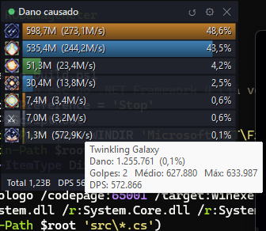

# RO Damage Meter

Medidor de dano (*damage meter*) em tempo real para **Ragnarok Online**, no estilo dos medidores de DPS de outros MMOs (Details!, Recount, Skada…).

Mostra, numa janela sobreposta ao jogo, **quanto dano cada skill sua está causando**, com ícone, total, DPS e porcentagem, e um tooltip com os detalhes de cada skill.



> Desenvolvido e testado no **RO LATAM**. Outros servidores podem usar versões de pacote diferentes (veja [Pacotes desconhecidos](#pacotes-desconhecidos)).

---

## ⚠️ Isto não é uma trapaça

Este projeto foi feito com uma regra central: **não interferir no jogo de forma alguma**. Ele não dá nenhuma vantagem; apenas faz a soma do dano que o próprio jogo já mostra na sua tela.

| Uma trapaça típica… | O RO Damage Meter |
|---|---|
| Lê ou altera a memória do jogo | ❌ **Não** abre o processo do jogo, não lê nem escreve memória |
| Injeta DLL / modifica o cliente | ❌ **Não** injeta nada e **não** toca em nenhum arquivo do jogo |
| Envia, altera ou bloqueia pacotes (bot, speed hack, dupe) | ❌ **Não** envia nem altera nada — só lê uma **cópia** do tráfego |
| Automatiza teclado/mouse (macro) | ❌ **Não** tem nenhuma automação de entrada |
| Revela informação escondida (HP oculto, jogador invisível…) | ❌ **Só** mostra o que o jogo já exibe ao jogador (os números de dano) |
| Se esconde do anti-cheat | ❌ **Não** se esconde: nome e descrição claros no executável, código aberto |

**Regra para qualquer funcionalidade futura:** o medidor só pode exibir informações que o próprio cliente do jogo já exibe ao jogador. Pull requests que quebrem essa regra não serão aceitos.

### Termos de uso

Mesmo sendo passivo, **verifique se ferramentas de terceiros são permitidas no seu servidor** antes de usar. Muitos termos de uso proíbem "programas de terceiros" de forma genérica. O recomendado é perguntar ao suporte do seu servidor e guardar a resposta. **Use por sua conta e risco** — os autores não se responsabilizam por punições em contas.

---

## Como funciona

O cliente do Ragnarok conversa com o servidor por TCP usando um protocolo binário. Para desenhar os números de dano na tela, o servidor envia ao cliente pacotes como *"a entidade X usou a skill Y no alvo Z e causou N de dano"*. O medidor lê uma cópia desses pacotes — da mesma forma que o [Wireshark](https://www.wireshark.org/) faz — e soma os valores.

```
 Placa de rede ──► Windows (raw socket, só leitura) ──► RO Damage Meter
                         │
                         └──► Ragexe.exe (o jogo recebe tudo normalmente, sem interferência)
```

1. **Encontrar a conexão do jogo** — consulta a tabela de conexões TCP do Windows (a mesma que o `netstat` mostra) e filtra as conexões do processo `Ragexe`. O processo do jogo não é aberto.
2. **Capturar** — um *raw socket* do Windows (`SIO_RCVALL`) recebe uma cópia dos pacotes IP daquela interface. Nenhum driver extra (Npcap/WinPcap) é instalado. Por isso o programa precisa de **administrador**.
3. **Remontar o TCP** — junta os segmentos na ordem certa e trata retransmissões e perdas.
4. **Separar os pacotes do RO** — cada pacote começa com um ID de 2 bytes; o tamanho é fixo ou vem no próprio pacote. Se o medidor for aberto no meio da sessão (ou encontrar um pacote desconhecido), ele se ressincroniza sozinho procurando uma sequência de pacotes válidos.
5. **Somar o dano** — considera só os golpes cuja origem é o seu personagem e agrupa por skill.

### Pacotes utilizados

Apenas pacotes **servidor → cliente**, que o jogo já usa para mostrar informação na tela:

| Pacote | ID | Uso |
|---|---|---|
| `ZC_NOTIFY_SKILL2` | `0x01DE` | Dano de skill (skill, origem, alvo, dano, nível, nº de hits) |
| `ZC_NOTIFY_SKILL` | `0x0114` | Versão antiga do anterior |
| `ZC_NOTIFY_ACT3` | `0x08C8` | Ataque básico (dano, crítico, mão esquerda) |
| `ZC_NOTIFY_ACT` / `ACT2` | `0x008A` / `0x02E1` | Versões antigas do anterior |
| `ZC_AID` | `0x0283` | Identifica o seu personagem ao entrar no mapa |
| `ZC_NPCACK_MAPMOVE` / `SERVERMOVE` | `0x0091` / `0x0092` / `0x0AC7` | Troca de mapa (nome do mapa) |
| `ZC_*ENTRY` | `0x09FD`–`0x09FF` | Entidades na tela (usado para identificar quem é você) |
| `ZC_USESKILL_ACK2` / `ZC_USE_SKILL2` | `0x07FB` / `0x09CB` | Confirmação de skill (usado para identificar quem é você) |

Os pacotes enviados pelo cliente são usados **somente** para comparar "a skill que eu pedi" com "a skill que o servidor confirmou", e assim descobrir qual é o seu personagem quando o medidor é aberto com o jogo já logado.

---

## Requisitos

- Windows 10 ou 11
- .NET Framework 4.x (já vem com o Windows)
- Permissão de administrador (para a captura)
- Jogo em **modo janela** ou **tela cheia sem borda** — em tela cheia exclusiva nenhuma janela consegue ficar por cima

## Compilar

Não precisa de Visual Studio nem de .NET SDK: o compilador C# do .NET Framework já vem no Windows.

```powershell
.\build.ps1
```

O resultado fica em `bin\RODamageMeter.exe` (junto com `skills.tsv`).

## Usar

1. Abra o jogo e entre com o personagem.
2. Abra `bin\RODamageMeter.exe` — o Windows vai pedir permissão de administrador (UAC). Na primeira vez o Firewall do Windows pode perguntar sobre o programa.
3. A bolinha no cabeçalho indica o estado: 🟢 capturando, 🟡 aguardando o jogo/conexão, 🔴 erro.
4. Ataque algo — as skills aparecem conforme causam dano.

### Funcionalidades

- **Dano por skill em tempo real**, ordenado do maior para o menor: ícone, total, DPS e % do total
- **Tooltip** ao passar o mouse: nome da skill, dano exato, %, golpes, dano médio, maior golpe, críticos e DPS
- **Reset** pelo botão ↺ ou pelo menu
- **Reset automático ao trocar de mapa** (ligado por padrão; teleporte dentro do mesmo mapa não reseta)
- Janela **sempre no topo**, arrastável pelo cabeçalho, redimensionável pelas bordas, com **opacidade ajustável** e opção de **travar**
- Rolagem com a roda do mouse quando há mais skills que espaço

Menu (⚙ ou clique direito): resetar, reset automático, opacidade, travar posição, abrir pasta, sair.

### Como o medidor sabe quem é você

Em ordem de confiança:

1. **Pacote `ZC_AID`**, enviado pelo servidor ao entrar em um mapa — exato.
2. **Confirmação de skill**: quando você usa uma skill num alvo, o servidor confirma "*X* usou a skill *Y* em *Z*"; se bate com o que o seu cliente acabou de pedir, *X* é você.
3. **Estimativa**: o seu personagem nunca aparece nos pacotes de "entidade na tela"; a fonte de dano mais ativa que não aparece neles é, muito provavelmente, você.

Se abrir o medidor com o jogo já logado, os primeiros golpes podem demorar alguns segundos para aparecer — eles são contados retroativamente assim que você é identificado. Trocar de mapa uma vez resolve de forma definitiva.

### Arquivos ao lado do executável

| Arquivo | Para quê |
|---|---|
| `skills.tsv` | Nomes das skills (ID → nome), gerado a partir do `skill_db` do rAthena |
| `icons\` | Cache dos ícones das skills, baixados do Divine Pride na primeira vez que cada skill aparece |
| `settings.ini` | Posição, tamanho, opacidade, reset automático, trava |
| `pacotes.txt` | *(opcional)* tamanhos de pacotes extras, sem recompilar |
| `pacotes_desconhecidos.log` | IDs de pacote que o medidor ainda não conhece |

### Pacotes desconhecidos

O protocolo muda conforme a versão do cliente. Quando aparece um pacote com ID desconhecido, o medidor perde o alinhamento por um instante, ressincroniza e registra o ID em `pacotes_desconhecidos.log`. Para ensinar o tamanho dele sem recompilar, crie `bin\pacotes.txt`:

```
# 0xID  TAMANHO   (-1 = tamanho variável, informado no próprio pacote)
0x0B1F  33
0x0A3B  -1
```

Se descobrir tamanhos novos, abra uma issue ou PR para incluí-los em `src/Protocol.cs`.

### Modo replay (testes sem o jogo)

Reproduz um fluxo servidor → cliente salvo em arquivo, em pedaços aleatórios e começando no meio de um pacote (para testar o resync):

```powershell
.\bin\RODamageMeter.exe --replay captura_s2c.bin --delay 120
```

Não exige administrador.

---

## Estrutura do código

| Arquivo | Responsabilidade |
|---|---|
| `src/Capture.cs` | Tabela de conexões do Windows, raw socket, remontagem TCP |
| `src/Protocol.cs` | Tabela de tamanhos de pacote, separação de pacotes e resync |
| `src/DamageTracker.cs` | Soma do dano por skill, identificação do personagem, troca de mapa |
| `src/OverlayForm.cs` | Interface (barras, tooltip, menu, arrastar/redimensionar) |
| `src/SkillDb.cs` | Nomes e ícones das skills, configurações |
| `src/Program.cs` | Inicialização, elevação para administrador, modo replay |

## Próximos passos

- [ ] Dano **recebido**, separado por monstro e skill do monstro
- [ ] Nomes das skills em português/espanhol
- [ ] Histórico de lutas e exportação
- [ ] Dano de homúnculo / invocações

## Créditos

- [rAthena](https://github.com/rathena/rathena) — nomes e IDs de skills (`skill_db.yml`) e referência dos layouts de pacote
- [OpenKore](https://github.com/OpenKore/openkore) — referência de pacotes por servidor
- [Divine Pride](https://www.divine-pride.net/) — ícones das skills

Ragnarok Online é marca registrada da Gravity Co., Ltd. Este projeto não tem nenhuma afiliação com a Gravity ou com qualquer servidor.

## Licença

[GPL-3.0](LICENSE) — o `skills.tsv` é derivado do banco de dados do rAthena, que também é GPL-3.0.
